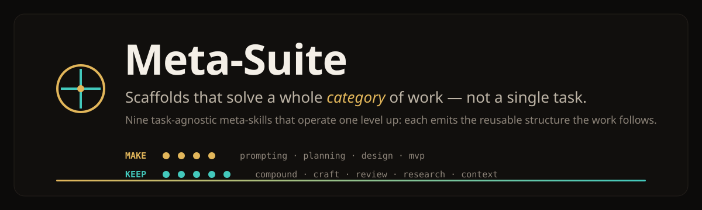
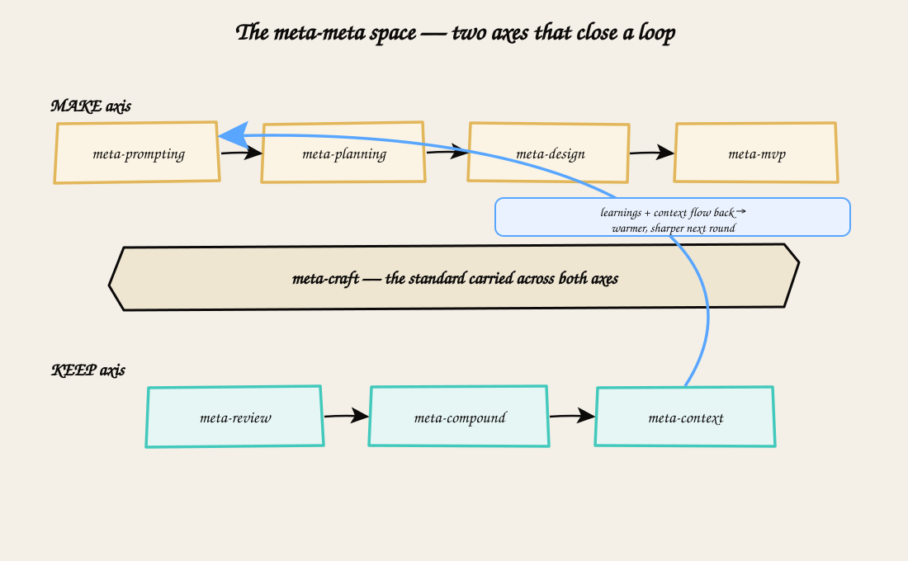

<div align="center">



<br/>


[](https://github.com/manutej/meta-suite/actions/workflows/validate.yml)


**Task-agnostic scaffolds that solve a whole _category_ of work — not a single task.**<br/>
Nine meta-skills that operate **one level up**: instead of doing the work, each one emits the
reusable structure the work follows. Think, plan, design, build, compound, craft, review, research,
and remember — for any project.

**[Install](#install) · [Every tool](INSTALL.md) · [The nine skills](#the-nine-skills) · [How it fits together](#how-it-fits-together-the-meta-meta-space) · [Why meta-prompting](#why-meta-prompting) · [Design promises](#design-promises) · [Web page](landing/index.html)**

</div>

---

## Why this exists

Most prompting solves one task at a time. You write a prompt, get an answer, and start from scratch
on the next problem. **Meta-suite works one level up.** Each skill takes whatever you're doing and
hands back the *structure* that solves the whole category it belongs to — a reusable scaffold you
can run now and reuse forever.

The nine skills fall on two axes. The **make** axis turns an idea into a shipped thing. The **keep**
axis makes that thing good, durable, and self-improving — so each project leaves you better equipped
for the next one.

## The nine skills

### → The *make* axis — idea to shipped thing

| Skill | Invoke | What it emits |
|---|---|---|
| **meta-prompting** | `/meta-suite:meta-prompting` | A reusable meta-prompt: *how to think* about a task category, not a worked example. |
| **meta-planning** | `/meta-suite:meta-planning` | A meta-plan: the typed scaffold a fleet of agents executes — before the plan is written. |
| **meta-design** | `/meta-suite:meta-design` | A medium-specific design schema, executed into an audited artifact plus the system that generates it. |
| **meta-mvp** | `/meta-suite:meta-mvp` | A one-liner expanded into a full, research-grounded deliverable bundle. |

### → The *keep* axis — good, durable, self-improving

| Skill | Invoke | What it emits |
|---|---|---|
| **meta-compound** | `/meta-suite:meta-compound` | The compounding map: how each unit of work makes the next one easier, and where to invest first. |
| **meta-craft** | `/meta-suite:meta-craft` | A tailored craft constitution + an evidence-based Definition of Done. |
| **meta-review** | `/meta-suite:meta-review` | Adversarial multi-lens review: prioritized findings, blind-spot probes, a reusable lesson. |
| **meta-research** | `/meta-suite:meta-research` | A rigorous, cross-verified, source-cited brief with explicit confidence + reusable knowledge atoms. |
| **meta-context** | `/meta-suite:meta-context` | A context strategy + droppable-in memory scaffold so work compounds across sessions. |

> Every skill is **task-agnostic**: the same scaffold works for engineering, writing, design,
> research, and operations.

## How it fits together — the meta-meta space

The two axes close a loop: what you **build** gets **reviewed**, review feeds **compounding**,
compounding feeds **context**, and richer context sharpens the next round of **thinking**.

<div align="center">



*See [`docs/`](docs/) for the editable Excalidraw sources.*

</div>

```
        ┌─────────────── THINK ──────────────┐
        │  meta-prompting → meta-planning      │
        │        → meta-design → meta-mvp      │   the MAKE axis
        └──────────────────┬───────────────────┘
                           │  produces the thing
                           ▼
        ┌────────────── KEEP ─────────────────┐
        │  meta-review → meta-compound          │
        │     → meta-context  (+ meta-craft     │   the KEEP axis
        │     setting the standard throughout)  │
        └──────────────────┬───────────────────┘
                           │  learnings + context flow back
                           └──────────► next THINK (warmer, sharper)
```

## Install

**Claude Code** (CLI, desktop, web, IDE). Run this inside a session:

```
/plugin marketplace add manutej/meta-suite
/plugin install meta-suite@meta-suite
```

Start a new session, then just describe what you want: each skill auto-triggers from its
description. You can also invoke one directly with `/meta-suite:meta-review`, `/meta-suite:meta-mvp`,
and so on (plugin skills are namespaced).

**Codex, Cursor, Grok Build, Copilot, Gemini CLI, and others:** one command.

```bash
npx skills add manutej/meta-suite --skill '*' -g -a codex -a cursor -a grok
```

**claude.ai / Claude Desktop, ChatGPT, Grok, and raw APIs** use the ready-made packages in
[`dist/`](dist/): one zip per skill for upload, plus single-file prompts for tools without skills.

**→ [INSTALL.md](INSTALL.md)** has exact steps for every tool, update instructions, and troubleshooting.

## Why meta-prompting

Meta-prompting grew out of a simple observation: instead of writing a fresh prompt for every new
task, you can write **one reusable prompt that teaches a model how to think about a whole category of
problems.** Rather than feeding worked examples, you give it a structured scaffold — roles, steps,
and slots to fill — that stays the same no matter the specific question. A model can even apply this
to itself, generating and refining its own prompts as it works.

This plugin is grounded in **Zhang, Yuan & Yao, "Meta Prompting for AI Systems"**
([arXiv:2311.11482](https://arxiv.org/abs/2311.11482)), which formalizes example-agnostic
meta-prompts. The lineage also includes **Suzgun & Kalai, "Meta-Prompting: Enhancing Language Models
with Task-Agnostic Scaffolding"** ([arXiv:2401.12954](https://arxiv.org/abs/2401.12954)) — source of
the "task-agnostic scaffolding" framing — and **de Wynter et al., "On Meta-Prompting"**
([arXiv:2312.06562](https://arxiv.org/abs/2312.06562)), the categorical "prompting-to-obtain-prompts"
analysis.

## Design promises

Every skill in meta-suite holds to four promises:

- **Self-contained.** No skill depends on a *third-party* plugin or external product — install
  meta-suite alone and everything works. Two skills (meta-design, meta-mvp) can *optionally* compose
  other skills for higher fidelity when those happen to be installed, and degrade gracefully without them.
- **Never asks you questions.** Each skill infers what it needs and proceeds, stating its assumptions
  in a line — no interrogation, no back-and-forth.
- **Clear over clever.** Output is plain and usable. The formal machinery that powers each skill
  stays out of your way unless you ask to see the internal work.
- **It compounds.** Several skills end by leaving behind something reusable — a lesson, an atom, a
  scaffold — so the next run starts ahead of the last.

## Repository layout

```
meta-suite/
├── .claude-plugin/
│   ├── plugin.json          # Claude Code plugin manifest
│   └── marketplace.json     # marketplace entry (/plugin marketplace add manutej/meta-suite)
├── skills/                  # the nine meta-* skills (SKILL.md + references/) — the source of truth
├── dist/                    # generated packages for every other tool (see INSTALL.md)
├── scripts/                 # validate.py (integrity gate) · package.py (builds dist/)
├── .github/                 # hero asset + validate CI workflow
├── docs/                    # workflow diagrams (Excalidraw + SVG)
├── landing/                 # the project web page (index.html)
├── _archive/                # internal meta-plan & specs — PRUNABLE, safe to delete
├── INSTALL.md               # per-tool install guide
├── README.md
└── LICENSE
```

> `_archive/` holds the internal reasoning that produced this plugin. It is not needed at runtime —
> `rm -rf _archive` for a leaner public release.

## License

MIT © 2026 Manu. See [LICENSE](LICENSE).
